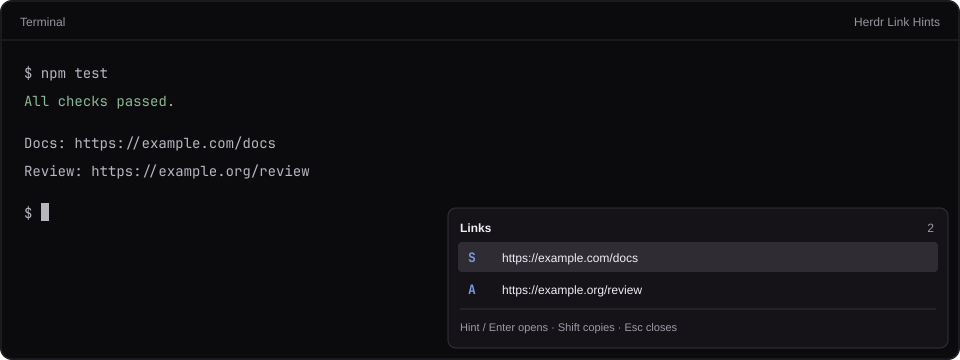

# Herdr Link Hints

Open links from your keyboard in **Herdr's desktop app**, inspired by Foot's
URL mode. Press **Ctrl+Shift+O**, then type the letter beside a link.

The popup stays in the bottom-right corner, sizes itself to its contents,
and leaves the terminal undimmed. It follows your Herdr theme.

Development is hosted on Gitea; GitHub is the public push mirror.



*Illustrative preview using example URLs. No real terminal content is included.*

## Requirements

- [Herdr desktop app](https://github.com/herdrdev/herdr-app), tested on **0.1.12**.
- `hc` (herdr-core), available to Herdr. Tested on **0.1.17**.
- A default browser for opening links.

This is a desktop **mod**, not a plugin for the older Herdr TUI. No packages
or additional services are required at runtime.

## Install

Clone this repository and read `RECIPE.md`, `mods/link-hints/main.js`, and
`mods/link-hints/links.js` before installing. Mods run trusted JavaScript.

1. Find your app folder: `$HERDR_APP_HOME` if set, otherwise
   `~/.config/herdr-app`. Each independently configured profile has its own
   app folder.
2. Copy `mods/link-hints/` into that folder's `mods/` directory. If a
   `link-hints` folder already exists, back it up and compare it first.
3. Back up the app folder's `keys.json`. Merge this binding into its
   existing `global` section, replacing the old Ctrl+Shift+O binding:

   ```json
   {
     "global": {
       "ctrl-shift-o": "mod.open:link-hints"
     }
   }
   ```

   `keys.json` in this repository is a snippet, **not a replacement for your
   entire key file**. In Herdr 0.1.12, Ctrl+Shift+O normally splits a pane;
   this intentionally replaces that shortcut. More specific `terminal` or
   `layout:*` bindings for the same key take precedence; update those too
   if needed.
4. Validate the installed mod, replacing the path for a custom profile:

   ```sh
   herdr-app check ~/.config/herdr-app/mods/link-hints
   herdr-app status
   ```

Herdr reloads the files automatically. Focus a terminal and press
Ctrl+Shift+O. Repeat installation for any other app profiles you use.

You can also ask your coding agent:

> Read this repository's RECIPE.md and source, then install the link-hints
> mod into my Herdr desktop app. Merge its key snippet into my existing
> keys.json, replacing Ctrl+Shift+O's pane split binding. Back up changed
> files and run herdr-app check afterward.

## Controls

| Key | Action |
| --- | --- |
| Ctrl+Shift+O | Open or close link hints |
| Hint letters | Open that link immediately |
| Shift on the final hint letter | Copy that link instead |
| Up / Down, Tab / Shift+Tab | Select a link |
| Enter / Shift+Enter | Open / copy the selection |
| PageUp / PageDown, Home / End | Move through longer lists |
| Backspace | Remove one hint letter |
| Escape / Ctrl+C | Close |
| Click / Shift+click | Open / copy that row |

Clicking outside also dismisses the popup. Hover a truncated URL to see
the full address.

Hints use Foot's `sadfjklewcmpgh` alphabet. With more than 14 links, all
hints gain another letter, so a short hint never opens the wrong link
while you type a longer one. Duplicate URLs appear once.

## Scope and limitations

- Detects visible `http://`, `https://`, and `www.` addresses.
- Reads the focused terminal's **current program screen** once when opened.
  It does not read the app's independently scrolled viewport or its history.
- Hidden destinations in OSC 8 hyperlinks are unavailable through this API.
- URLs broken by actual newlines are not joined or guessed.
- Labels appear in a list. Herdr's current mod API cannot paint badges
  directly onto terminal cells.
- Terminal search, keyboard selection, and copy mode are separate features.

## Data access

The mod calls `hc read --json --lines 0 <focused-terminal>` through Herdr's
`hc()` API. This uses the current profile's connection, including qualified
remote terminal addresses. It never requests history or sends terminal input.

Terminal text stays in memory while the popup is open. The mod does not
fetch URLs, record terminal text, use telemetry, or store credentials. It
opens the selected URL with Herdr's system-browser API, or writes it to the
clipboard when explicitly requested. Its source has no external imports
beyond Herdr's built-in modules.

## Customize

Edit `mods/link-hints/mod.json` to change the width (480 logical pixels by
default) or maximum height (300). The popup fits its content and displays
at most six link rows; the keyboard can reach all remaining links.

The deliberately off-screen `at` coordinates use Herdr 0.1.12's popup
clamping to anchor it 8 pixels inside the bottom-right window edge. This
also follows window resizing. Theme colors come from `theme()`.

## Update or remove

For updates, compare this repository's `mods/link-hints/` with your installed
copy, back up any local edits, copy the changed files, and run
`herdr-app check` again. Do not overwrite unrelated settings.

To remove it, dismiss the popup, remove the `mod.open:link-hints` binding
from your app's `keys.json`, and remove that app folder's
`mods/link-hints/` directory. Restore your previous binding if wanted.
Repeat for other profiles where you installed it.

## Development

Requires Node.js 22 or newer for the tests; no npm dependencies:

```sh
npm test
herdr-app check "$PWD/mods/link-hints"
```

The tests cover URL extraction, duplicate handling, hint uniqueness,
keyboard open/copy/navigation, focus capture, cancellation, and read errors.
The UI harness mocks Herdr, so also inspect the mod in a running app after
UI changes. Never automate keys on someone else's real terminal to test it.

`RECIPE.md` describes how to rebuild the mod from scratch. `preview.svg` is
the editable source for the illustrative preview; regenerate the PNG with
`rsvg-convert preview.svg -o preview.png`.

## License

[MIT](LICENSE). Inspired by Foot's interaction; no Foot source is included.
