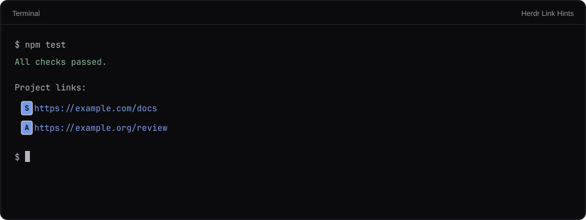

# Herdr Inline Selectors

A configurable native inline picker for links, explicit shell commands, image paths,
and local extensions. The default shortcuts are Ctrl+Shift+O, Ctrl+Shift+X, and
Ctrl+Shift+I. F2 toggles window/inline mode; F3 cycles enabled selectors.

## What you see

Use a transparent, frameless full-window overlay with themed letter badges just
before each match. Duplicate values share a hint at every occurrence. Hints use
Foot's sadfjklewcmpgh alphabet with a uniform width, so none prefixes another.
There is no inline footer or loading card. Wait for config, snapshot, and font
measurement. Fall back to a compact bottom-right card when alignment is unsafe.
The card has a title, count/prefix, reachable paged rows and controls. Fit row
count to viewport height; allow scrolling when the whole card exceeds it.

## How it behaves

A completed hint, Enter or click activates; Shift copies the exact value instead.
Arrows, Tab, paging, Home/End and Backspace navigate. Escape, Ctrl+C and the
current selector's shortcut dismiss. Another configured shortcut switches the
selector. F2 and F3 work directly from the focused overlay, including F2 while
loading. Selector navigation keys stay out of the source terminal.

Links open HTTP(S) destinations. Commands are explicit prefixed logical lines
(default !). Activation types the selected command, with its configured bang
prefix, into the exact source terminal without Enter. The person reviews and
submits it in Codex/Claude, where the usual command/output/failure flow remains.
An optional run-command adapter opens a separate Bash tab. Image paths open a configured local viewer.
Nothing runs during extraction, rendering, loading, or partial hint input.

Configuration lives in selectors.json beside keys.json and reloads on opening.
Use legacy link-hints.json only if the new file is absent. Default mode is inline;
keep existing explicit modes on migration. Merge built-in selector defaults with
custom entries and support disabled selectors, custom regex captures, URL
parameter templates, and separate process argv. plugins.js exports matcher and
action maps for local extensions. See selectors.example.json and README.md for
the concrete schema and contracts.

## Built from

Canonical runtime source is mods/link-hints/. selectors.js owns config, matcher
registry, candidate labelling/positioning, and paging. actions.js owns the action
registry and dispatch. plugins.js supplies local extensions without engine edits.
main.js captures focus, loads config/snapshot, renders, and handles native events.
geometry.js measures layout bounds and infers the grid. links.js retains URL/OSC
extraction and hint encoding. snapshot.py captures a bounded read-only observer;
terminal_grid.py decodes physical cells and UTF-16-to-cell position mappings.
terminal_input.py uses hc's framed attach protocol for literal UTF-8 input,
at the current terminal dimensions, without Enter, resize frames or clipboard
changes. Reject blocked approval dialogs, controls and multiline input. On a
transfer failure keep the selector open and visibly show the error even in
inline mode. Preserve the selected command for manual retry; never retry
automatically. If a failure happens after writing, warn that the input may
already be present.

Capture focused().shown, then terminal, then agent before focusing the overlay.
Read hc read --json --lines 0 once. In parallel, the Python helper obtains
terminal dimensions and foreground directory with hc get --json, then captures
hc attach --observe --history 0. Keep stdin open but write nothing; cap startup
at five seconds and data at 4 MiB; stop at a quiet gap or 0.4 seconds of continuous
output; clean up only the observer client. Do not request history or scroll apps.

Use the read API's logical text to preserve soft-wrapped values and real newlines.
Locate complete matches against decoded physical rows for badges. Retain explicit
OSC 8 positions. Account for wide/combining characters and JS UTF-16 indices.
Unsupported terminal transformations disable speculative inline positioning.

Calculate bounds from live layout(), including resized nodes, hidden blocks,
padding, dividers and pane frames. Measure the actual settings().font_family at
medium weight with a 128-M probe. Native bounds round up; account for that bounded
per-character error when comparing columns. Infer a unique row height compatible
with terminal rows/device scale. Snap origins and convert through native zoom.
Inline requires complete positioning, one pane or a zoomed pane, and unchanged
viewport/typography. Other cases use the card with a notice.

scripts/install.py creates self-contained launchers for each configured selector.
Imports must remain within each mod root, so copy the canonical engine as
selector.js inside non-default launchers and generate a tiny main.js subclass
with its selector ID. Merge configured shortcuts, refuse unrelated key/mod
collisions, back up changed files, preserve dotfile symlinks, and refresh an
existing mod-directory symlink to trigger reload. Generate custom selector
launchers too. Build-only output enables native validation before installation.

## Watch out

Herdr's independently scrolled viewport and offscreen history are not available
through this API. Return to the bottom for inline selection; reopen after output
moves. Snapshots do not freeze the program. Do not join actual newline fragments.
Built-in image viewing is local; remote retrieval needs an extension. Shell
execution is an explicit selected action; pass the selected command as a separate
argument to a fixed Bash script. Other process argv must never be shell-joined.

## Done when

Automated tests cover original link controls, wrapped full values, cell mappings,
command/image/custom actions, config errors/migration, shortcut collisions,
long-list paging, prefix-free hints, and observer cleanup. Build and pass
herdr-app check for every launcher. Inspect the native badge/window UI using a
disposable test terminal; never automate keys on someone's real terminal.
QA.md defines the subsequent manual QA and lists the remaining host limitations.
