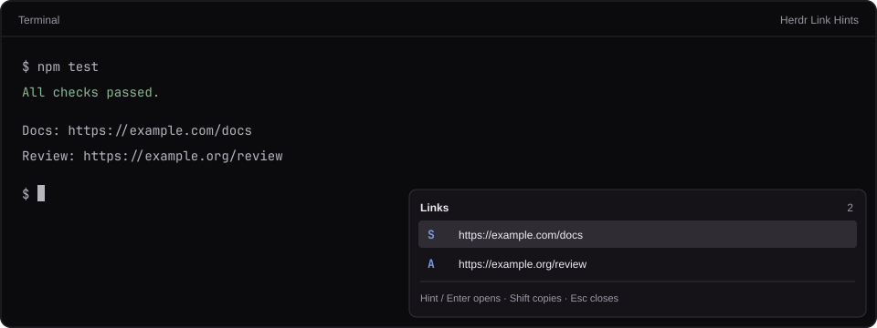

# Herdr Link Hints

A compact keyboard link picker for Herdr's desktop app. Ctrl+Shift+O shows
letter labels next to URLs from the focused terminal. It sits in the
bottom-right corner without dimming the rest of the window.

## What you see

A popup 480 logical pixels wide, with a height fitted to its content and
capped at 300 pixels. It sits 8 pixels inside the bottom-right window edge.
Its root has 10 pixels of padding and 6-pixel vertical gaps.

The header reads “Links”. During a multi-letter hint, the typed prefix
appears beside it. The right edge shows the link count, or the selected
row's position and an arrow indicator for more than six matches.

Up to six rows appear at once. Each is 28 pixels high, with a 28-pixel hint
column and an 8-pixel gap before the URL. Selected rows use the theme's
`selected` color. URL text truncates, with the full URL in a hover tooltip.

A small footer says “Hint / Enter opens · Shift copies · Esc closes”. There
is no backdrop dimming, large title, separate hint input, duplicate URL
preview, or empty vertical filler. Colors use `theme()` tokens: `popover`,
`foreground`, `muted`, `accent`, `input`, `selected`, `hover`, and `border`.
Hints use JetBrains Mono, while the rest follows the app's UI font.

## How it behaves

Ctrl+Shift+O toggles the popup. Capture the focused terminal before the
popup takes focus, preferring `focused().shown`, then `.terminal`, then
`.agent`. Do not choose an arbitrary other terminal if none has focus.

Read that terminal's program screen exactly once, with
`hc(["read", "--json", "--lines", "0", terminal])`. While loading, say
“Reading links…”. If there are no URLs, show that state; on read errors,
show a short message rather than opening another terminal or retrying forever.
In parallel, a bundled Python 3 helper captures a brief repaint with
`hc attach --observe --history 0 <terminal>`. Read OSC 8 destinations from
that repaint so named links work. The helper sends no input, never resizes,
and terminates only its own observer after a quiet gap or a bounded deadline.
If this optional read fails, retain visible URL results and show a notice.
Agent working/blocked/idle/done states do not change the display or cause
polling: this is a one-time snapshot when a person asks for it.

Detect http, https, and www URLs, and OSC 8 http(s) destinations terminated
by BEL or ST. Preserve explicit OSC 8 URLs exactly, including punctuation.
Deduplicate hidden destinations and visible URLs together.
For visible URL text, remove surrounding prose punctuation and
unmatched closing brackets while preserving balanced parentheses. Validate
addresses with `URL`, normalize only for duplicate detection, and preserve
the original URL spelling when opening. Prefix www addresses with https.

Assign hints using `sadfjklewcmpgh`. Use the shortest uniform hint length
that accommodates the list, retaining screen order. All hints must have
equal length so none is a prefix of another.

Typing a complete hint opens its URL in the default browser. Shift on the
last letter copies it instead. Arrow keys or Tab move the selection;
Enter opens and Shift+Enter copies. PageUp/PageDown, Home/End, and Backspace
work too. The selected row stays visible as the list moves. Escape, Ctrl+C,
or the opening shortcut closes it. Clicking a row opens it; Shift+click
copies. An outside click dismisses it.

Capture all keys while open so they do not reach a running agent. Ignore
unrelated modified letters and held-key hint events. Never open a URL on
loading, rendering, or partial hint entry. Close after opening/copying and
show a short copy confirmation. No scrolling, pane creation, or program input.

## Built from

No layout file or persistent panel. This is one mod under `mods/link-hints/`:

- `mod.json`: `place: "none"`, with a `popup` overlay, width 480, maximum
  height 300, and `at: {x: 1000000, y: 1000000}`. Herdr's native popup
  clamping places this at the bottom-right edge as the window resizes.
- `main.js`: a `View` with a keyboard focus handle and native `v_flex`,
  `h_flex`, and `div` elements. `props().overlay` identifies the overlay to
  dismiss with `closeOverlay()`.
- `links.js`: URL extraction, deduplication, and hint assignment.
- `snapshot.py`: bounded read-only observer capture with Python's standard
  library, never an interactive terminal or persistent background service.
- A root `keys.json` snippet maps global Ctrl+Shift+O to
  `mod.open:link-hints`; merge it with existing keys.

Use `theme()`, `focused()`, `hc()`, `props()`, `closeOverlay()`, and
`notify()`, `exec()`, and `appHome()` from `herdr`. Locate the bundled helper
under the current app home and run it locally with Python 3. Use the current event's `cx.open_url()` or
`cx.write_to_clipboard()` only after a person chooses a link. No shipped
mods, third-party packages, network fetches, background polling, or art
assets are needed by the runtime. `preview.svg` and `preview.png` are
documentation-only illustrations with example URLs.

## Watch out

Tested with Herdr app 0.1.12 and hc 0.1.17. Read the installed app's
`AGENTS.md` and generated type files for its actual API. Keep contexts local
to their callbacks. Run the read in `cx.spawn`, not on the rendering path.

Use a content-sized root for a popup, not a full-height flex column. The
large `at` coordinates deliberately rely on native edge clamping; a popup
must retain a small margin and stay on-screen after a resize.

Plain screen reads do not expose hidden OSC 8 destinations; the read-only
repaint is needed for those. Neither follows the app's separate scrollback
viewport. Do not guess across actual newline boundaries. Native
inline labels, terminal search, and keyboard copy mode are out of scope.

Back up existing mod/key files before installing. Ctrl+Shift+O normally
splits a pane in this Herdr release; replacing it is intentional. More
specific bindings can override the global key. Each profile has its own
app home and needs its own installation.

## Done when

- `npm test` passes for URL extraction and keyboard behavior.
- `herdr-app check <app-home>/mods/link-hints` passes and status has no errors.
- Ctrl+Shift+O opens the popup without creating a pane or dimming the app.
- One-link, duplicate-link, no-link, failed-read, and multi-letter-hint
  states work. Every link is reachable in a list longer than six rows.
- A named hyperlink is detected even when its destination is absent from
  visible text. BEL/ST forms, exact URL punctuation, and duplicates work.
- Observer failure degrades to visible links with a notice; a snapshot
  never types, resizes, or leaves its helper process running.
- A complete hint opens the right URL; Shift copies without opening;
  partial hints and unrelated modified keys open nothing.
- Escape and an outside click dismiss it and return focus to the terminal.
- A screenshot confirms a compact bottom-right popup with readable hints.
- No terminal text, credentials, customer configuration, or real session
  screenshot is included in the published package.
